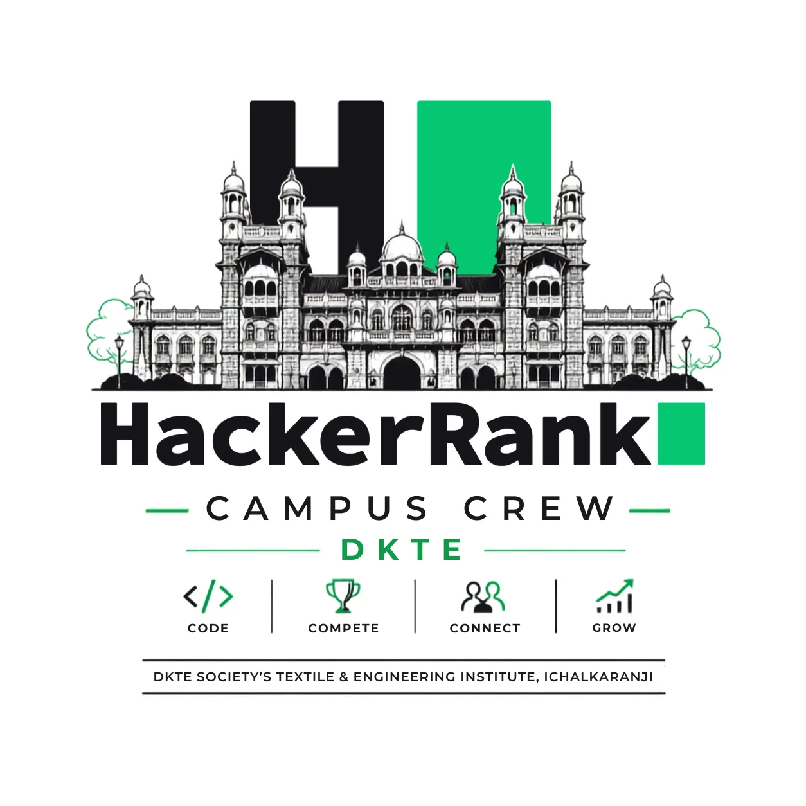

<div align="center">

<a href="https://www.hccdkte.dev/">
  
</a>

# HackerRank Campus Crew &middot; DKTE
### DKTE Society's Textile & Engineering Institute, Ichalkaranji
**An Autonomous Institute &middot; Student Developer Community**

<p align="center">
  <em>The student developer community where DKTE builders gather to write code, solve problems, ship real software, and grow together.</em>
</p>

[](https://www.hccdkte.dev/)
[](https://discord.gg/3ydEQyM3v4)
[](https://www.linkedin.com/company/hackerrank-campus-crew-dkte)
[](https://www.instagram.com/hackerrank.dkte/)
[](https://hackerrank.com)

---

</div>

## 🚀 More Than a Website — A Community of Builders

> **"Built by students, for students."**  
> We believe the deepest learning happens when you get your hands dirty with real code, team up with passionate peers, and solve tangible problems together.

**HackerRank Campus Crew (HCC) at DKTE** is a **student-led, open-door engineering and builder collective**. We aren't an exclusive club or just a web application — we are a community of students who love technology, software, hardware, and problem solving.

Whether you are:
- 🐣 **A beginner** compiling your very first lines of `C++` or `Python`,
- 🧩 **A problem solver** mastering data structures, algorithms, and competing in algorithmic challenges,
- 🛠️ **A full-stack builder** building web apps, APIs, developer tools, and micro-services,
- 🤖 **An enthusiast** exploring AI/ML, cloud architecture, IoT, robotics, or cybersecurity,

**HCC is where you find your squad, sit down with mentors, and turn wild ideas into working code.**

---

## 🏛️ How We Grow: The Four Pillars

<div align="center">

```
                        ┌────────────────────────┐
                        │    HCC DKTE CHAPTER    │
                        └───────────┬────────────┘
         ┌──────────────┬───────┴───────┬──────────────┐
         ▼              ▼               ▼              ▼
     01. LEARN      02. BUILD      03. COMPETE    04. CONNECT
   Foundations &   Software &      Contests &     Community &
        DSA        Open Source     Hackathons     Mentorship
```

</div>

| Pillar | What We Focus On | Community Experience |
| :--- | :--- | :--- |
| 🧠 **01 // LEARN** | **Foundations & Problem Solving** | Hands-on code-alongs, peer-to-peer debugging, breaking down complex data structures, and mastering core CS principles from the ground up. |
| 🛠️ **02 // BUILD** | **Software Engineering & Open Source** | Turning classroom theory into shipped products. We build campus developer tools, internal utilities, team hackathon projects, and contribute to open source. |
| 🏆 **03 // COMPETE** | **Coding Contests & Hackathons** | Regular chapter contests on HackerRank, timed speed-coding sprints, campus leaderboard showdowns, and national hackathon delegations. |
| 🤝 **04 // CONNECT** | **Peer Mentorship & Shared Growth** | No hierarchies, no silos. Seniors and juniors sitting at the same lab desks, reviewing pull requests, sharing interview roadmaps, and building together. |

---

## 💡 Our Culture & Builder Tenets

Our community culture is shaped by principles that encourage action over perfection:

1. **Learn in Public** 📢  
   Don't hide your code until it is "perfect". Share your work-in-progress, write about what you learned today, open draft pull requests, and ask questions fearlessly.
2. **Build Before You Feel Ready** 🚀  
   Tutorials only take you so far. Real engineering begins when you hit runtime exceptions, resolve merge conflicts, and debug with friends. Ship a prototype first; iterate together.
3. **Help Someone Behind You** 🤝  
   If you figured out a tricky recursion concept or Git rebase yesterday, help someone who is struggling with it today. When one of us grows, the whole crew levels up.
4. **Radical Openness & Zero Gatekeeping** 🌍  
   It doesn't matter what department you belong to (CSE, AIML, IT, EnTC, Electrical, Mechanical, Textile). If you want to build and solve problems, you have a seat at our table.

---

## 🎯 What Happens Inside HCC

- 💻 **Hands-on Technical Workshops:** Practical, zero-fluff sessions covering Git & GitHub, Modern Full-Stack (Next.js, TypeScript, React), Python, Docker, Cloud Systems, and System Design.
- ⚡ **HackerRank Coding Contests:** Regular algorithmic sprints designed to sharpen analytical thinking and build interview muscle.
- 🚀 **Hackathons & Build Sprints:** Team-based campus hackathons where students form multi-disciplinary squads to build real solutions for college and community challenges.
- 🎖️ **Verifiable Digital Credentials:** Verifiable cryptographic badges and certificates earned through active project contributions, contest performance, and workshop attendance.
- 🎓 **Peer Mentorship & Career Prep:** Resume clinics, mock technical interviews, open-source onboarding, and interactive fireside chats with alumni in tech.
- 🌐 **In-House Campus Projects:** Student-designed and developed tools, including our unified community platform powering events, showcases, and collaboration.

---

## 📦 Community Repositories

Explore and contribute to our open-source ecosystem:

| Repository | Description | Primary Stack |
| :--- | :--- | :--- |
| [🌐 **HCC-platform**](https://github.com/HCC-DKTE-Organization/HCC-platform) | The central digital platform for DKTE students — event registrations, project showcases, attendance verification, and member profiles. | Next.js 15, TypeScript, Tailwind CSS, Supabase, Vercel |
| [📋 **.github**](https://github.com/HCC-DKTE-Organization/.github) | Community health files, issue templates, PR guidelines, and organization profile configuration. | Markdown, GitHub Actions |

*More student projects, starter templates, and community tools are constantly incubated by our squads.*

---

## 🤝 How to Join & Start Building

You don't need prior coding experience or an invitation to be part of HCC. Here is how you jump in:

1. **💬 Join the Discord Server**  
   Drop into our [Discord Community](https://discord.gg/3ydEQyM3v4) and say hi in `#introductions`. It’s our 24/7 hub for peer help, voice study rooms, tech discussions, and updates.
2. **👤 Create Your Profile**  
   Register on the [HCC Community Portal](https://www.hccdkte.dev/) to RSVP for upcoming campus workshops, submit projects to the campus showcase, and track your achievements.
3. **💻 Grab a Good First Issue**  
   Explore our repositories, find an issue tagged `good first issue`, fork the repo, and submit your pull request. Our team conducts constructive, friendly code reviews to help you get your code merged!
4. **⚡ Show Up to Offline Build Sprints**  
   Join our weekend coding sessions, lab meetups, and campus competitions right here at DKTE.

---

## 🌐 Community Channels & Links

Stay connected with our initiatives, contests, and announcements:

- 🌍 **Official Website:** [www.hccdkte.dev](https://www.hccdkte.dev/)
- 💬 **Discord Community:** [discord.gg/3ydEQyM3v4](https://discord.gg/3ydEQyM3v4)
- 💼 **LinkedIn:** [linkedin.com/company/hackerrank-campus-crew-dkte](https://www.linkedin.com/company/hackerrank-campus-crew-dkte)
- 📸 **Instagram:** [@hackerrank.dkte](https://www.instagram.com/hackerrank.dkte/)
- ⚡ **HackerRank:** [hackerrank.com](https://hackerrank.com)

---

<div align="center">

<sub>&copy; 2026 HackerRank Campus Crew &middot; DKTE Society's Textile & Engineering Institute, Ichalkaranji</sub><br/>
<sub>**Built with ❤️ by students, for students.**</sub>

</div>
